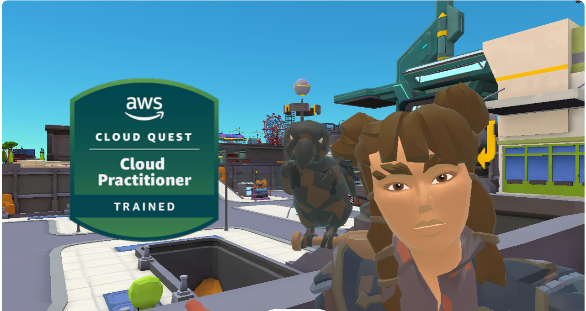
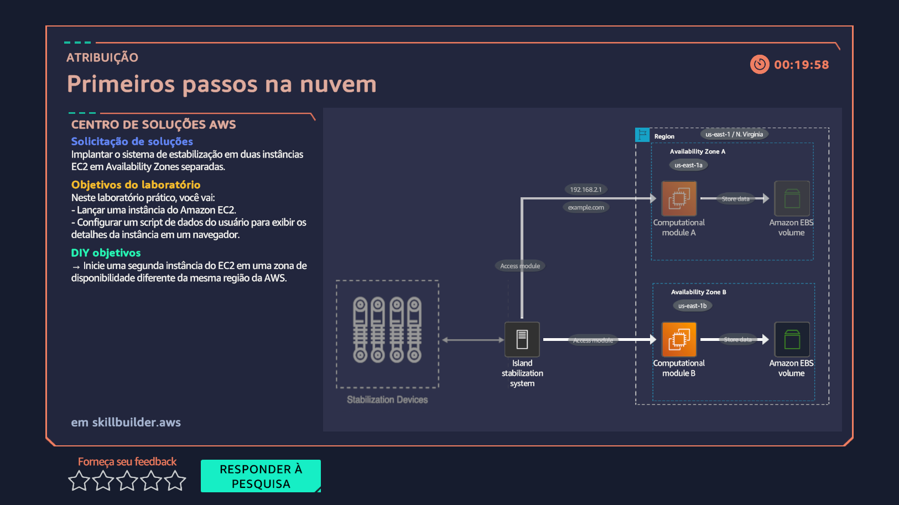
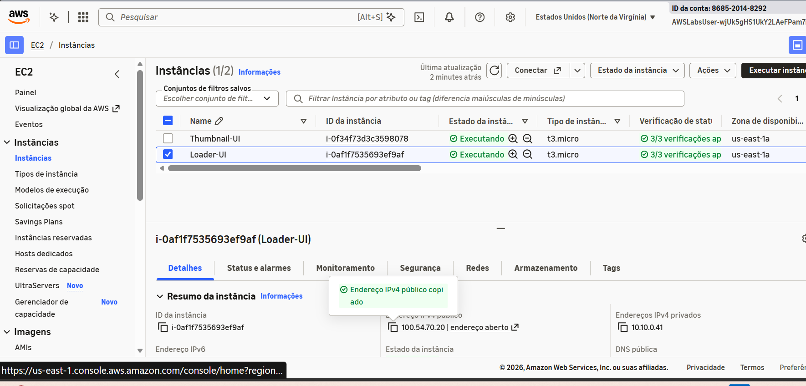
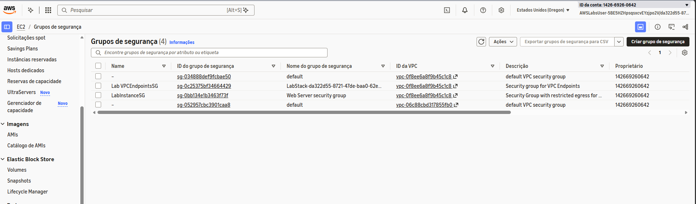

# ☁️ Desafio DIO — Gerenciamento de Instâncias EC2 na AWS

  
  
  
  

## 📌 Sobre o Projeto

Este projeto foi desenvolvido como parte de um laboratório prático da **Digital Innovation One (DIO)**, com o objetivo de explorar os principais recursos do **Amazon Elastic Compute Cloud (Amazon EC2)**.

Durante o laboratório, foram realizadas atividades de criação, configuração, acesso remoto e monitoramento de uma instância EC2 na infraestrutura da Amazon Web Services (AWS).

O projeto também tem como finalidade documentar os conhecimentos adquiridos e servir como registro prático de aprendizado em Cloud Computing.

Atualmente trabalho como Analista de Informática na MKTechSolutions e tive a oportunidade de participar do AWS Cloud Quest: Cloud Practitioner.

---

## 🎯 Objetivos

- Compreender o funcionamento do Amazon EC2.
- Criar e configurar uma instância virtual na AWS.
- Conhecer os conceitos de segurança e controle de acesso.
- Realizar conexão remota com a instância.
- Explorar ferramentas de monitoramento da AWS.
- Documentar as atividades utilizando Git e GitHub.

---

## ☁️ O que é Amazon EC2?

O **Amazon Elastic Compute Cloud (EC2)** é um serviço de computação em nuvem da AWS que permite provisionar e gerenciar servidores virtuais sob demanda.

Com ele, é possível:

- 🚀 Hospedar aplicações e serviços.
- 🗄️ Executar bancos de dados.
- 💻 Criar ambientes de desenvolvimento e testes.
- 📈 Escalar recursos computacionais conforme a necessidade.
- 🔐 Configurar regras de segurança e acesso à infraestrutura.

---

## ⚙️ Configurações da Instância

| Recurso | Configuração |
|---|---|
| Serviço | Amazon EC2 |
| AMI | Amazon Linux 2023 |
| Instance Type | t2.micro |
| Região | US East (N. Virginia) — us-east-1 |
| Armazenamento | 8 GB |
| Estado | Running |
| Método de conexão | EC2 Instance Connect |

---

## 🛠️ Etapas do Laboratório

### 1. Acesso ao Console AWS

Foi realizado o acesso ao AWS Management Console para explorar os serviços de computação em nuvem.

### 2. Criação da Instância EC2

Foi criada uma instância utilizando a imagem Amazon Linux 2023, com as configurações apresentadas anteriormente.

### 3. Configuração do Security Group

Foi configurado um Security Group para controlar o tráfego de entrada da instância.

| Tipo | Protocolo | Porta |
|---|---|---|
| SSH | TCP | 22 |
| HTTP | TCP | 80 |

> **Nota de segurança:** em ambientes de produção, recomenda-se restringir a origem das conexões SSH a endereços IP confiáveis, evitando a exposição desnecessária da porta 22.

### 4. Inicialização da Instância

Após a configuração, a instância foi iniciada com sucesso, apresentando o seguinte estado:

`Running`

### 5. Conexão Remota

Foi utilizado o **EC2 Instance Connect** para estabelecer uma conexão remota com a máquina virtual diretamente pelo navegador.

### 6. Monitoramento

Foi explorado o monitoramento da instância por meio do Amazon CloudWatch, permitindo acompanhar métricas como:

- CPU Utilization;
- Network In;
- Network Out;
- Status Checks.

---

## 📚 Conceitos Aprendidos

| Conceito | Descrição |
|---|---|
| **Amazon Machine Image (AMI)** | Modelo utilizado para iniciar instâncias EC2, contendo sistema operacional e configurações. |
| **Instance Type** | Define a capacidade computacional, incluindo CPU, memória e rede. |
| **Security Groups** | Funcionam como firewall virtual, controlando o tráfego de entrada e saída. |
| **Elastic IP** | Endereço IPv4 público estático que pode ser associado a recursos AWS. |
| **Amazon CloudWatch** | Serviço de monitoramento de métricas, logs e eventos da infraestrutura. |
| **EC2 Instance Connect** | Permite estabelecer conexões SSH com instâncias EC2 pelo navegador ou linha de comando. |

---

## 📸 Evidências do Laboratório

As imagens abaixo documentam as principais etapas realizadas durante o laboratório.

### Minha posição atual:

### Primeiros Passos na Nuvem

### Instância em execução

### Grupos de Segurança

---

## 💡 Considerações Finais

A realização deste laboratório proporcionou uma experiência prática com os fundamentos de computação em nuvem da AWS.

Foi possível compreender o processo de provisionamento de uma máquina virtual, configuração de regras de segurança, acesso remoto e monitoramento de recursos computacionais.

Além do conhecimento técnico, o exercício reforçou a importância da documentação de projetos e da utilização do GitHub como ferramenta de organização e compartilhamento de conhecimento.

**Este laboratório representa mais um passo na minha jornada de aprendizado em Cloud Computing e infraestrutura em nuvem.** 🚀

---

## 🔗 Referências

- [Amazon EC2 — AWS](https://aws.amazon.com/ec2/)
- [Documentação oficial do Amazon EC2](https://docs.aws.amazon.com/ec2/)
- [AWS CloudWatch](https://aws.amazon.com/cloudwatch/)
- [Digital Innovation One — DIO](https://www.dio.me/)

---

  Desenvolvido com ☁️ e dedicação aos estudos de Cloud Computing.

